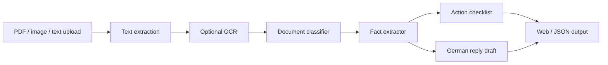

# Auslander Doc Assistant

[](https://github.com/amandesi13/auslander-doc-assistant/actions/workflows/ci.yml)\n[](https://www.python.org/)\n[](https://fastapi.tiangolo.com/)\n[](#)\n[](LICENSE)\n

Privacy-first document assistant for international students and newcomers in Germany.

The goal is simple: upload a German bureaucracy document, letter, contract, PDF, or image and get a plain-English explanation, extracted deadlines, required documents, action checklist, and a polite German reply draft.

This is not legal advice. It is a product prototype for reducing document anxiety and helping people understand what to do next.

## Why This Product Exists

International students in Germany receive important documents in formal German from universities, Ausländerbehörde offices, health insurers, landlords, employers, banks, and public services. The hard part is often not translation alone. The hard part is knowing:

- What is this document?
- What do I need to do?
- Which documents are required?
- Is there a deadline?
- Is there a fee?
- Should I reply?
- Does this affect work hours, residence permit rules, or enrollment?

`auslander-doc-assistant` turns a document into a calm action plan.

## Features

- Upload/analyze PDF, image, or text files.
- Extract selectable PDF text with PyMuPDF.
- Optional OCR for scanned documents and images.
- Detect common Germany document types:
  - residence permit / Ausländerbehörde letters
  - Anmeldung documents
  - health insurance requests
  - rental contracts
  - university enrollment documents
  - student job / HiWi / Werkstudent contracts
  - Rundfunkbeitrag letters
- Extract dates, deadlines, fees, contact emails, and working-hour references.
- Generate action checklist.
- Generate polite German reply draft.
- Local-first prototype: no cloud upload required.

## Quick Start

```bash
python -m pip install -e ".[dev]"
auslander-doc examples/hiwi_admin_request.txt -o analysis.json
```

Run web app:

```bash
auslander-doc-web
```

Open:

```text
http://localhost:8200
```

Docker:

```bash
docker compose up --build
```

## Example CLI Output

```text
Detected: health_insurance
Wrote: analysis.json
```

The JSON contains:

- document type
- plain-English summary
- extracted facts
- required documents
- action items
- deadline candidates
- fee candidates
- German reply draft

## Architecture



## Product Roadmap

- Add local SQLite document vault.
- Add ICS calendar reminder export for deadlines.
- Add document-specific checklists for residence permit, Anmeldung, health insurance, and job contracts.
- Add optional LLM explanation mode with privacy warning.
- Add German/English side-by-side translation using the `pdf-de2en-ocr-lens` engine.
- Add mobile-first UI.
- Add "ask a clarification question" email templates.

## Recruiter-Relevant Engineering Signals

This project demonstrates:

- Consumer product thinking around a real pain point.
- Document ingestion and OCR architecture.
- Rule-based NLP/fact extraction.
- FastAPI web app design.
- Privacy-first UX.
- Tests, Docker, and CI.

## Disclaimer

This project does not provide legal, immigration, tax, or employment advice. It helps users organize information and prepare questions. Always verify with the responsible authority, university, employer, health insurer, or qualified advisor.

## License

MIT
